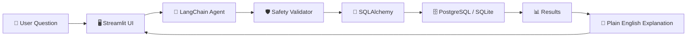

# 🔍 Text-to-SQL Agent

[](https://www.python.org/)
[](https://www.langchain.com/)
[](https://www.postgresql.org/)
[](https://www.docker.com/)
[](LICENSE)

A **LangChain-powered agent** that converts natural language questions into SQL queries, executes them safely against your database, and explains results in plain English. Uses **Ollama** (free, local LLM) by default with OpenAI as an optional fallback.


---

## Architecture



---

## Prerequisites

| Requirement | Purpose | Required? |
|---|---|---|
| **Python 3.10+** | Runtime | ✅ Yes |
| **Ollama** with `llama3.2` | Local LLM | ✅ Yes (or use OpenAI) |
| **PostgreSQL 15** | Production database | ❌ Optional — SQLite sample DB included |
| **Docker & Compose** | Containerised setup | ❌ Optional |

---

## 🚀 Quickstart (zero config)

Works immediately with the bundled SQLite sample database — no PostgreSQL needed.

```bash
# 1. Clone the repo
git clone https://github.com/Revanthpotu/text-to-sql-agent.git
cd text-to-sql-agent

# 2. Create a virtual environment
python -m venv .venv && source .venv/bin/activate

# 3. Install dependencies
pip install -r requirements.txt

# 4. Generate the sample e-commerce database
python database/sample_data.py

# 5. Make sure Ollama is running with a model
#    (install from https://ollama.com, then:)
ollama pull llama3.2

# 6. Launch the app
streamlit run app.py
```

Open **http://localhost:8501** and start asking questions!

---

## 🐘 PostgreSQL Setup

```bash
# 1. Copy and edit the env file
cp .env.example .env
# Edit .env: set USE_SAMPLE_DB=false and fill in DB_* variables

# 2. Run the app
streamlit run app.py
```

Or configure the connection directly in the Streamlit sidebar.

---

## 🐳 Docker Quickstart

```bash
# Start the app + PostgreSQL + Ollama
docker compose up --build -d

# Pull a model into the Ollama container
docker compose exec ollama ollama pull llama3.2

# Open http://localhost:8501
```

---

## 💡 Example Questions

| Question | Expected SQL Type |
|---|---|
| How many customers do we have? | `COUNT(*)` |
| What are the top 5 products by price? | `ORDER BY … LIMIT` |
| Show total revenue by order status | `SUM() … GROUP BY` |
| Which city has the most customers? | `COUNT … GROUP BY … ORDER BY` |
| What is the average order amount? | `AVG()` |
| List orders placed in the last 30 days | `WHERE … date filter` |
| Which products are low in stock (< 20)? | `WHERE … < 20` |
| Show the top 3 customers by total spending | `JOIN … SUM … GROUP BY … LIMIT` |

---

## 🛡️ Safety Features

The agent includes a **mandatory safety validator** that runs before every query execution.

**Blocked operations:**

- `DROP` — cannot drop tables or databases
- `DELETE` — cannot delete rows
- `UPDATE` — cannot modify existing data
- `INSERT` — cannot add new rows
- `TRUNCATE` — cannot empty tables
- `ALTER` / `CREATE` — cannot change schema
- `GRANT` / `REVOKE` — cannot change permissions

**Only `SELECT` queries (and `WITH … SELECT` CTEs) are allowed.** The validator checks every query regardless of how it was generated — even if the LLM attempts a dangerous operation, the validator blocks it before it reaches the database.

---

## 📁 Project Structure

```
text-to-sql-agent/
├── app.py                      # Streamlit UI
├── agent/
│   ├── __init__.py
│   ├── llm_config.py           # LLM factory (Ollama / OpenAI)
│   ├── prompts.py              # System prompts
│   ├── safety.py               # SQL safety validator
│   ├── schema_inspector.py     # Database introspection utilities
│   └── sql_agent.py            # Core agent logic
├── database/
│   ├── __init__.py
│   ├── connection.py           # SQLAlchemy engine factory
│   └── sample_data.py          # Sample e-commerce data generator
├── tests/
│   ├── __init__.py
│   ├── test_agent.py           # Integration tests
│   ├── test_safety.py          # Safety validator tests
│   └── test_schema.py          # Schema inspector tests
├── .env.example                # Environment variable template
├── .gitignore
├── Dockerfile
├── docker-compose.yml
├── LICENSE
├── Makefile
├── README.md
└── requirements.txt
```

---

## ⚙️ Configuration

| Variable | Description | Default |
|---|---|---|
| `USE_SAMPLE_DB` | Use bundled SQLite database | `true` |
| `DB_HOST` | PostgreSQL host | `localhost` |
| `DB_PORT` | PostgreSQL port | `5432` |
| `DB_NAME` | PostgreSQL database name | — |
| `DB_USER` | PostgreSQL user | — |
| `DB_PASSWORD` | PostgreSQL password | — |
| `OLLAMA_MODEL` | Ollama model name | `llama3.2` |
| `OLLAMA_BASE_URL` | Ollama server URL | `http://localhost:11434` |
| `OPENAI_API_KEY` | OpenAI API key (optional) | — |

---

## 🧰 Tech Stack

| Component | Technology |
|---|---|
| **LLM Orchestration** | LangChain |
| **Default LLM** | Ollama (llama3.2) |
| **Optional LLM** | OpenAI (gpt-4o-mini) |
| **Database ORM** | SQLAlchemy |
| **Databases** | PostgreSQL 15, SQLite |
| **UI** | Streamlit |
| **Containerisation** | Docker & Docker Compose |
| **Testing** | pytest |

---

## 🧪 Running Tests

```bash
# Unit tests (no LLM needed)
pytest tests/test_safety.py tests/test_schema.py -v

# Full integration tests (requires Ollama or OpenAI)
pytest tests/ -v
```

---

## Make Commands

```bash
make install          # Install Python dependencies
make setup-sample-db  # Generate the sample SQLite database
make run              # Create sample DB + launch Streamlit
make test             # Run all tests
make docker-up        # Start Docker services
make docker-down      # Stop Docker services
make clean            # Remove generated files
```

---

## License

This project is licensed under the MIT License — see the [LICENSE](LICENSE) file for details.
